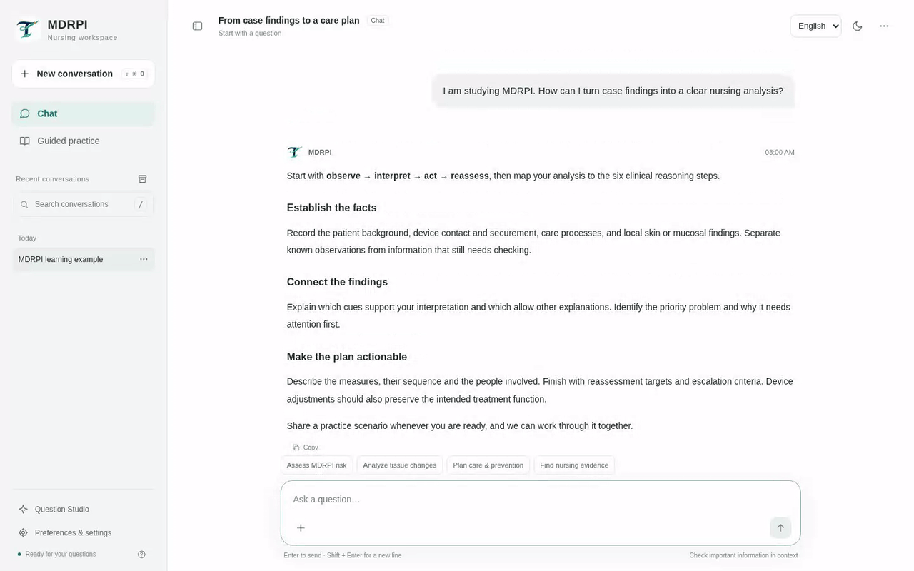
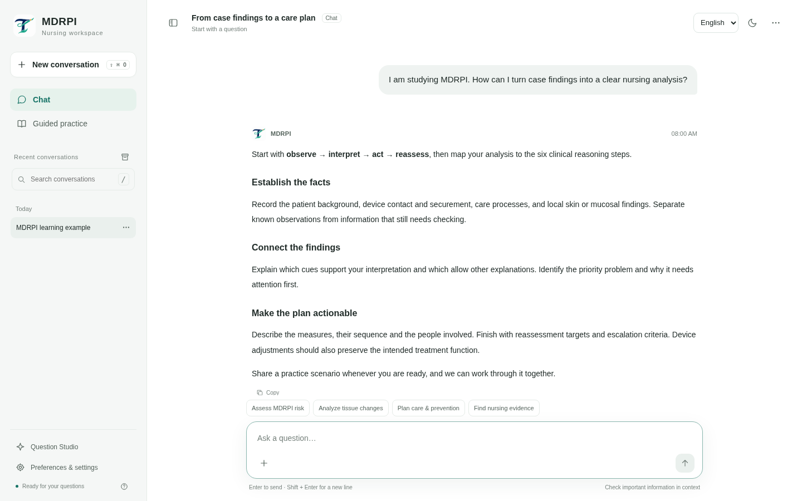
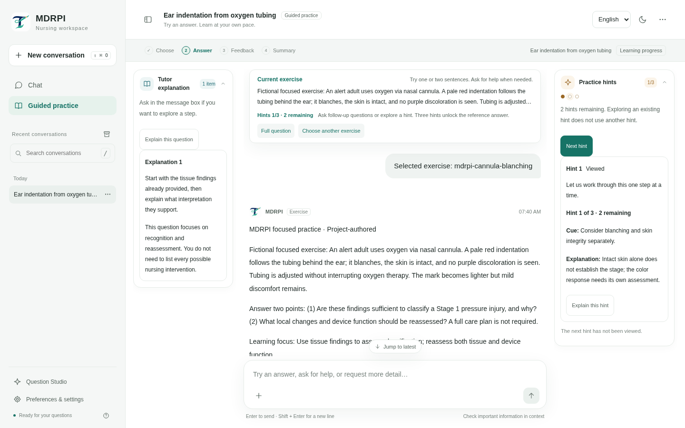
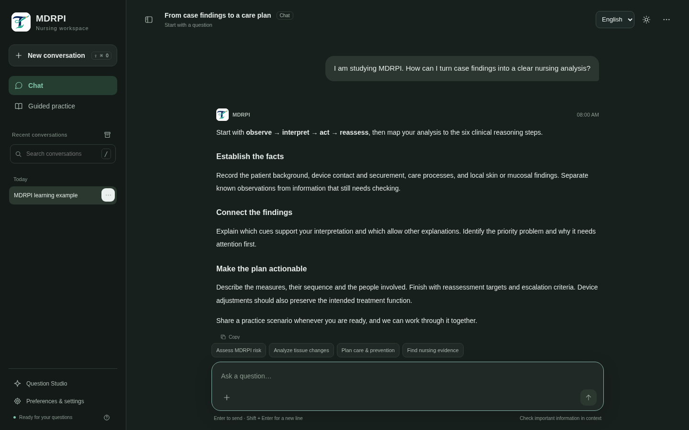
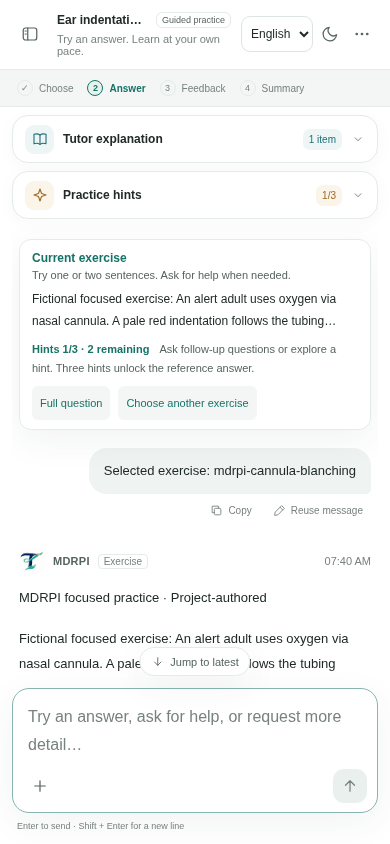
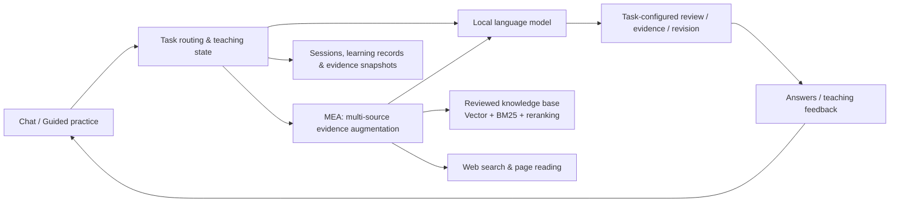

<div align="center">
  
  <h1>MDRPI-TRACE</h1>
  <p><strong>An evidence-informed AI agent for device-related pressure injury education</strong></p>
  <p>Clinical conversation · Guided nursing practice · Evidence-grounded question authoring</p>
  <p>
    <a href="LICENSE"></a>
    
    
  </p>
  <p><strong>English</strong> · <a href="README.zh-CN.md">简体中文</a></p>
  <p><a href="#demo">Demo</a> · <a href="#quick-start">Quick start</a> · <a href="docs/ARCHITECTURE.md">Architecture</a> · <a href="docs/DEPLOYMENT.md">Deployment</a> · <a href="docs/DATA.md">Data & teaching materials</a></p>
</div>

MDRPI-TRACE connects a local language model with knowledge retrieval, web evidence and guided practice for **medical device-related pressure injury (MDRPI)** education.

Learners use **Chat** and **Guided practice**. A separate **Question Studio** supports evidence-grounded question authoring. The six-step performance evaluation remains available through research interfaces, outside the learner mode menu.

## Demo

An English walkthrough of the actual interface: **Chat → light/dark themes → Guided practice → full question and hints → draft an answer**.



[Watch or download the MP4 version](https://github.com/yangzhicheng12138/MDRPI-TRACE/raw/refs/heads/main/docs/assets/demo.mp4) for playback controls and a clearer view.

The recording and screenshots use prewritten example conversations and a public fictional teaching exercise. They demonstrate real interface interactions, without live model inference; playback timing is not a model latency measurement.

<details>
<summary>Screenshots: Chat, Guided practice, dark theme and mobile layout</summary>

### Chat

Multi-turn conversations, Markdown answers, conversation history, attachments, themes and tools selected as needed.



### Guided practice

The question, answer draft, explanations and progressive hints share one workspace. Learners can refine an answer, explore a hint, review feedback and continue to the next step.



### Dark theme and mobile





</details>

## Features

| Capability | Implementation |
|---|---|
| Chat | Multi-turn sessions, tool routing, file reading, web search and recoverable streaming responses |
| Multi-source evidence augmentation (MEA) | Vector retrieval and BM25, RRF fusion and reranking, with population, device and source-admission filters |
| Web evidence | DeepSeek Search/Fetch with Baidu fallback on failure or empty results; additional search adapters are retained |
| Six-step reasoning | Recognize cues, analyze cues, prioritize hypotheses, generate solutions, take action and evaluate outcomes |
| Guided practice | Equivalent-answer assessment, progressive hints, explanations, formative feedback, learning records and review scheduling |
| Question authoring | Registered development materials, retrieved and web evidence, followed by independent model review and revision |
| Research workflows | Run records, evidence snapshots, structured exports and configurable review/revision pipelines |
| Bilingual interface | English/Chinese switch in Chat, Guided practice and Question Studio; response language is configured separately |

The public release includes **41 teaching examples**: 30 attributed Open RN adaptations, eight project-authored MDRPI exercises and three fictional practice scenarios. The full research bank, formal 30-case study set, experimental answers and scores are not distributed.

## Quick start

The web process runs on CPU. Start the workspace, then connect the model and knowledge services.

```bash
git clone https://github.com/yangzhicheng12138/MDRPI-TRACE.git
cd MDRPI-TRACE

python3 -m venv .venv
source .venv/bin/activate
python -m pip install -r requirements.txt

cp .env.example .env
python scripts/start_web.py
```

Open **http://127.0.0.1:8021/ui/**.

On Windows, use `python -m venv .venv`, `.venv\Scripts\Activate.ps1` and `Copy-Item .env.example .env` for the corresponding setup steps.

No search key is needed to open the workspace. **Generating answers requires a running local model.** Knowledge retrieval additionally requires your own reviewed documents and index. The interface reports dependencies that are unavailable.

### Choose a language

Use **English / 中文** in the top-right corner. The interface follows the browser language on first use and remembers your selection locally. It switches navigation, buttons, settings, hints-panel labels and workspace controls without changing saved conversations or answer drafts.

Set **Response language** independently in **Preferences & settings**. New sessions initially use the current interface language unless a response preference has already been saved. Changing the interface does not translate past answers, source documents or user-authored content. Bilingual catalog titles use their available English/Chinese versions.

### Connect a model

The default endpoint is `http://127.0.0.1:8001/v1`, with served model name `ministral-3-14b`. Set `MDRPI_LLM_BASE_URL` and `MDRPI_LLM_MODEL` in `.env`; configure context length in `config.yaml`.

The model service must support Chat Completions, SSE streaming, JSON Schema output constraints and the token-counting endpoint used by the project. Follow the [deployment guide](docs/DEPLOYMENT.md) for vLLM setup. Install model weights and any quantization runtime separately.

### Enable search

Add credentials to your local `.env`:

```dotenv
DEEPSEEK_API_KEY=
BAIDU_SEARCH_API_KEY=
```

Search defaults to **DeepSeek first, Baidu fallback**. Search planning uses the local model by default; set `search_planner.provider` to `deepseek` in `config.yaml` for external planning. External services are billed by their providers. Keep populated `.env` files out of Git.

### Prepare knowledge and authoring materials

Build a reviewed retrieval index from documents you are entitled to use. Publisher PDFs, research knowledge stores and model weights are not bundled. See the [data guide](docs/DATA.md).

Question Studio is available at `/question-studio/`. Register development materials and their review basis before generating questions. A fresh clone shows an empty material list; public example questions and formal study cases are not automatically used as authoring evidence.

## Architecture



See [architecture](docs/ARCHITECTURE.md) for module responsibilities and the question-authoring workflow.

## Development

```bash
python -m pytest -q
node --test tests_frontend/*.test.mjs
python scripts/check_release.py
```

Tests use mocked transports and fixed examples, without paid model calls by default. Model-quality evaluation requires a separately specified case set, model, evidence snapshots and scoring protocol. Engineering tests do not establish clinical effectiveness.

```text
app/                 Retrieval, evidence, model clients and reflection
modes/               Chat, teaching, authoring, state management and Web API
modes/frontend/      Browser interface; no build step required
data/teaching_bank/  Redistributable teaching examples and attribution
scripts/             Startup, index preparation and release checks
tests/, tests_modes/ Backend tests without live model dependencies
tests_frontend/      Interface-language regression tests (Node.js 22+)
tools/               Optional isolated tool worker
docs/                Demo, deployment, architecture and data documentation
```

## License & attribution

Original project code is licensed under the [MIT License](LICENSE). Teaching materials retain their stated licenses: Open RN source content is CC BY 4.0; supplied teaching adaptations are CC BY-SA 4.0. Third-party components retain their own terms; see [THIRD_PARTY_NOTICES.md](THIRD_PARTY_NOTICES.md). MIT does not replace those licenses.

The project draws on OATutor's progressive hints, FSRS review scheduling, and interaction ideas from Open WebUI and LibreChat. Attribution and licenses for reused code are retained in the repository.

Designed for nursing education and research. Qualified professionals should make patient-care decisions in the relevant clinical context.

Report reproducible issues or contribute through the [contribution guide](CONTRIBUTING.md).
