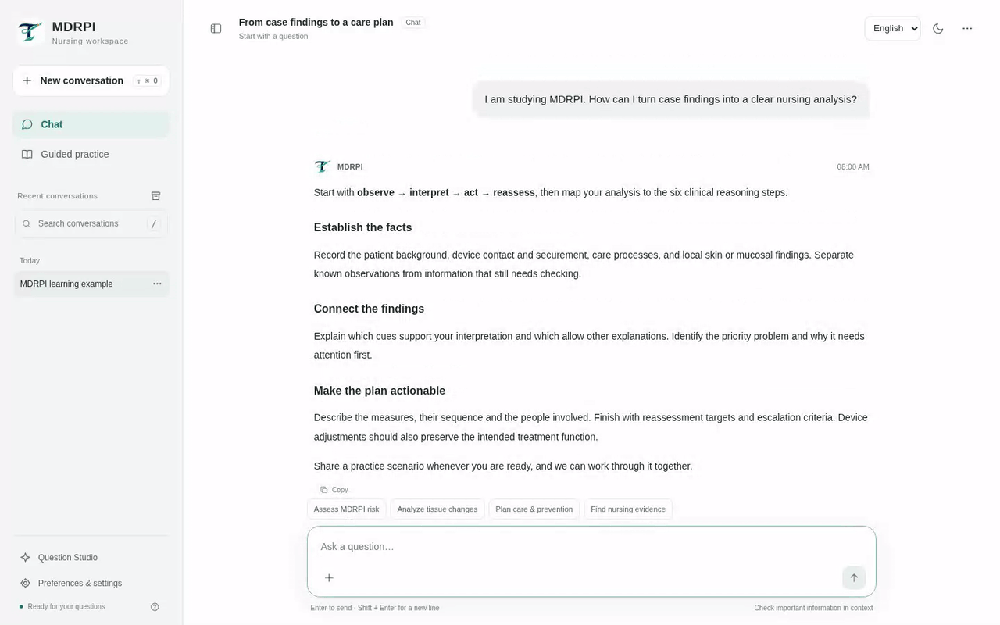
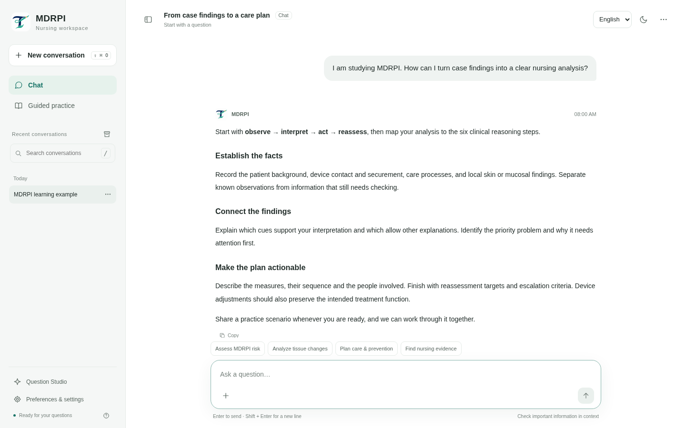
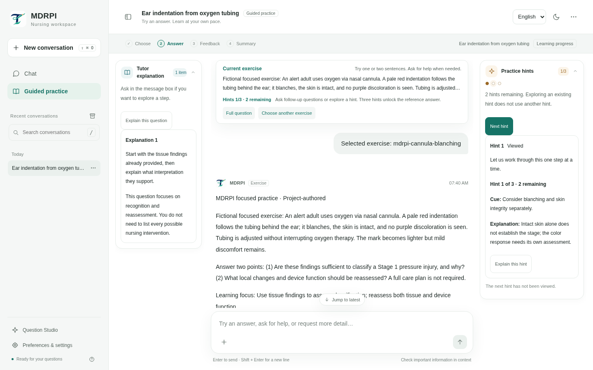
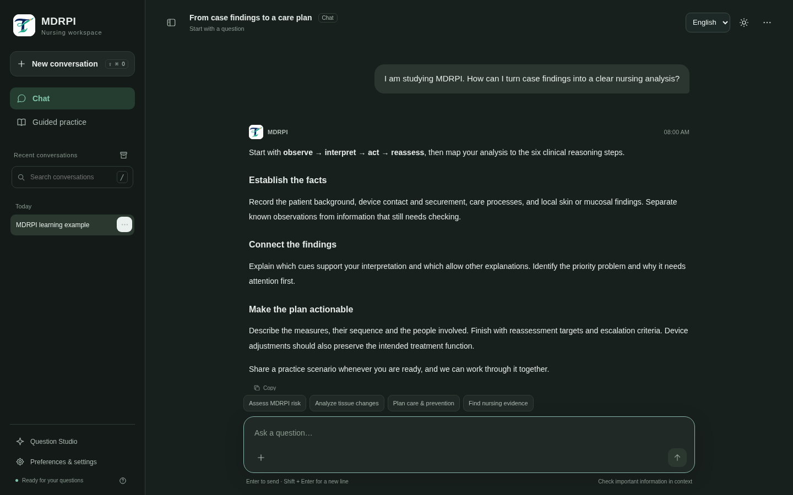
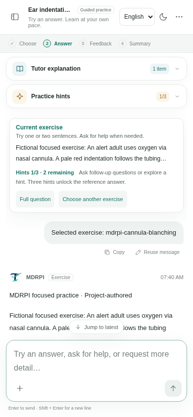
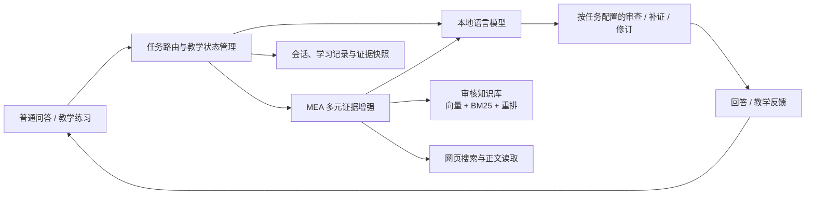

[English](README.md) · **简体中文**

<div align="center">
  
  <h1>MDRPI-TRACE</h1>
  <p><strong>面向器械相关压力性损伤的循证问答与临床推理教学智能体</strong></p>
  <p>Evidence-informed conversation · Clinical reasoning · Guided nursing practice</p>
  <p>
    <a href="LICENSE"></a>
    
    
  </p>
  <p><a href="#demo">Demo</a> · <a href="#快速开始">快速开始</a> · <a href="docs/ARCHITECTURE.md">架构</a> · <a href="docs/DEPLOYMENT.md">部署</a> · <a href="docs/DATA.md">数据与教学材料</a></p>
</div>

MDRPI-TRACE 将本地语言模型、知识库检索、网页取证与教学练习连接起来，支持围绕医疗器械相关压力性损伤（Medical Device-Related Pressure Injury, MDRPI）进行问答和临床推理训练。

用户界面提供 **普通问答** 和 **教学练习**。六步性能评测保留为研究接口，不出现在学习者的模式菜单中。

## Demo

英文界面的交互演示：**普通问答 → 深浅主题切换 → 教学练习 → 查看完整题目与提示 → 编辑作答草稿**。



[下载 MP4 清晰版（可暂停、拖动进度）](https://github.com/yangzhicheng12138/MDRPI-TRACE/raw/refs/heads/main/docs/assets/demo.mp4)

录屏与截图均来自本仓库实际前端，使用预置示例对话和公开教学样例展示交互；未调用真实模型，不代表推理速度或模型效果评价结果。

<details>
<summary>查看静态截图：普通问答、教学练习、深色主题与手机布局</summary>

### 普通问答

支持连续对话、Markdown 回答、历史会话、附件、主题切换和按需工具调用。



### 教学练习

将题目、作答、教学讲解和分层提示放在同一工作区。学生可以补充作答、追问已有提示、核对反馈，再进入下一步。



### 深色主题和手机布局





</details>

## 能做什么

| 能力 | 实现 |
|---|---|
| 普通问答 | 多轮会话、工具路由、文件阅读、网页检索、可恢复的流式回答 |
| 多元证据增强 | 向量检索与 BM25，经 RRF 融合和重排；按人群、器械及来源准入过滤 |
| 网页取证 | DeepSeek Search/Fetch，失败或无结果时回退到百度；同时保留其他检索适配器 |
| 六步临床推理 | 识别线索、分析线索、问题排序、生成方案、采取行动、评价结果 |
| 教学支持 | 等价答案判定、逐层提示、讲解、形成性反馈、学习记录和复习安排 |
| 教学命题 | 基于已登记材料、知识库与网页证据命题，再由独立模型审核和修订 |
| 研究支持 | 独立运行记录、证据快照、结构化导出，以及可配置的审查与修订流程 |

公开版本附带 **41 项教学样例**：30 项 Open RN 改编练习、8 项项目编写的 MDRPI 专项练习和 3 个虚构练习情景。完整研究题库、正式 30 例测试病例、实验回答和评分不随代码发布。

## 快速开始

网页进程使用 CPU。先启动工作台，再连接本地模型和知识库服务即可。

```bash
git clone https://github.com/yangzhicheng12138/MDRPI-TRACE.git
cd MDRPI-TRACE

python3 -m venv .venv
source .venv/bin/activate
python -m pip install -r requirements.txt

cp .env.example .env
python scripts/start_web.py
```

打开 **http://127.0.0.1:8021/ui/**。

Windows 下使用 `python -m venv .venv`、`.venv\Scripts\Activate.ps1` 和 `Copy-Item .env.example .env` 完成对应步骤。

启动页面不需要搜索密钥；**实际生成回答需要可用的本地模型**。知识库功能需要另行准备文献、审核记录与索引。没有连接依赖时，界面会如实显示服务状态。

### 连接模型

默认连接 `http://127.0.0.1:8001/v1`，模型服务名称为 `ministral-3-14b`。可在 `.env` 中设置 `MDRPI_LLM_BASE_URL`、`MDRPI_LLM_MODEL`，在 `config.yaml` 中设置上下文长度。

模型服务需兼容 Chat Completions、SSE 流式输出、JSON Schema 结构化输出及项目使用的 token 计数接口。推荐按 [部署文档](docs/DEPLOYMENT.md) 配置 vLLM；模型权重及量化运行环境分别安装。

### 开启搜索

在本机 `.env` 中填写：

```dotenv
DEEPSEEK_API_KEY=
BAIDU_SEARCH_API_KEY=
```

搜索默认采用 **DeepSeek 优先、百度备用**。搜索规划默认由本地模型执行；将 `config.yaml` 的 `search_planner.provider` 设为 `deepseek` 可启用外部规划。外部服务按各提供方规则计费。不要提交填写了密钥的 `.env`。

### 配置知识库和出题材料

检索代码支持使用自有文献建立审核索引。公开仓库不附带出版社 PDF、研究知识库或模型权重。准备流程见 [数据文档](docs/DATA.md)。

出题工作台位于 `/question-studio/`。登记合法持有的开发材料及其审核依据后可以使用；新克隆的仓库显示空材料列表，不会把示例题或正式测试病例自动作为命题依据。

### 中英文界面

点击右上角 **English / 中文** 即时切换，浏览器会记住选择。首次访问跟随浏览器语言。界面语言与设置中的“回复语言”独立；历史回答、原文材料和输入草稿不会被自动翻译。

## 系统结构



完整模块关系和命题流程见 [架构说明](docs/ARCHITECTURE.md)。

## 开发与验证

```bash
python -m pytest -q
python scripts/check_release.py
```

测试使用模拟传输与固定样例，默认不调用付费模型。模型效果验证需要另行确定病例、模型、证据快照和评分方案；本仓库的工程测试不等同于临床有效性验证。

```text
app/                  检索、证据、模型客户端与反思流程
modes/                问答、教学、命题、状态管理和 Web API
modes/frontend/       无构建步骤的浏览器前端
data/teaching_bank/   可分发的教学样例及来源信息
scripts/              启动、索引建设与发布检查
tests/, tests_modes/  不依赖真实模型的工程测试
tools/                可选隔离工具工作进程
docs/                 Demo、部署、架构和数据说明
```

## 许可证与来源

项目原创代码采用 [MIT License](LICENSE)。教学材料采用其标注的许可（Open RN 原始内容为 CC BY 4.0，项目教学改编为 CC BY-SA 4.0）；第三方组件和依赖保留各自许可证，见 [THIRD_PARTY_NOTICES.md](THIRD_PARTY_NOTICES.md)。MIT 不改变这些组件或资料的许可。

本项目参考了 OATutor 的分层提示机制、FSRS 的复习调度，以及 Open WebUI、LibreChat 的部分交互设计。已复用代码的来源和许可证保留在仓库中。

面向护理教学与研究使用。涉及患者的实际处置应由合格专业人员结合临床情况判断。

欢迎通过 Issue 报告可复现的问题，或按 [贡献指南](CONTRIBUTING.md) 提交改进。
