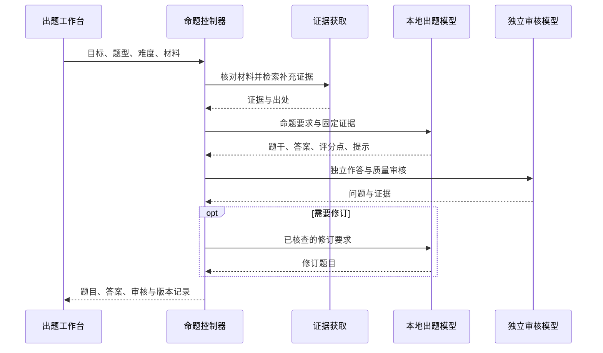

# MDRPI-TRACE 系统架构

## 交互与状态

FastAPI 提供 API 与静态网页，LangGraph 管理回合状态，SQLite 保存会话和教学检查点。普通问答使用任务规划选择工具；教学使用题目、学习者作答、提示曝光和反馈记录组织交互。学生作答与教师讲解分开记录。

前端以 HTML、CSS 和 ES Modules 实现，包含普通问答、教学练习和独立出题工作台；不需要 Node 构建。研究性能流程仍可通过开发接口调用，不作为学习者模式展示。

## 证据获取

MEA 指本项目中的 Multi-source Evidence Augmentation（多元证据增强），包含本地审核知识库和外部网页证据。

- 本地：Qdrant 向量检索与 BM25 词法检索，RRF 合并候选，再通过重排器排序。
- 适用性：审核准入、人群、器械、材料类型与来源范围参与过滤。成人、儿童和新生儿证据保留适用范围。
- 联网：搜索候选网页、读取正文、保留出处，再选择可支持当前任务的片段。DeepSeek Search/Fetch 为默认适配器，百度为备用。
- 可追溯：文献元数据、来源位置、证据文本、检索事件和运行快照分别保存。

## 推理、教学和反思

本地模型生成回答或教学反馈。六步任务将临床推理组织成识别、分析、排序、方案、行动和评价。审查与修订是可配置的流程，而不是每条聊天消息都会运行的固定步骤。

教学按题目评分点接收等价表达，保留原始作答和提示记录。三级提示与完整参考答案的访问规则分开。讲解不会被当成学生能力证据。明显停在引导语的教学回复会自动补全一次。

## 教学命题

命题材料必须独立登记，不从学习者会话中自动抽取，也不将正式测试病例混入开发材料。生成结果保留在开发工作区，不自动写入正式题库。

## 运行边界

网页、模型和知识库为独立进程。仓库保留原生工具调用与编排代码；不要求启动独立 MCP 服务。可选文件生成和计算由隔离工作进程处理，配置见部署文档。
