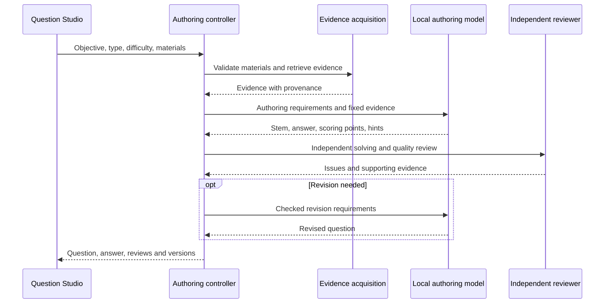

# MDRPI-TRACE architecture

## Interaction and state

FastAPI serves the API and static interface. LangGraph manages turn state; SQLite stores sessions and teaching checkpoints. Chat uses a task planner to select tools. Guided practice organizes questions, learner answers, hint exposure and feedback, recording student work separately from teacher explanations.

The frontend uses HTML, CSS and ES modules with no build step. It provides Chat, Guided practice and a separate Question Studio. Research performance workflows remain accessible through development interfaces, outside the learner mode menu.

The English/Chinese interface uses a local message catalog and a persistent browser preference. Localization updates UI labels and accessibility attributes while preserving editable values, backend enum values and generated content. Response language is an independent session preference. Async panel loading uses stable internal identifiers, not translated display text.

## Evidence acquisition

**MEA** means **Multi-source Evidence Augmentation** in this project: a reviewed local knowledge base plus external web evidence.

- **Local retrieval:** Qdrant vector search and BM25 lexical search, RRF candidate fusion, then reranking.
- **Applicability:** review admission, population, device, material type and source scope filter the evidence. Adult, pediatric and neonatal applicability is retained.
- **Web evidence:** search candidate pages, read their text, retain provenance and select passages relevant to the current task. DeepSeek Search/Fetch is the default adapter; Baidu is the fallback.
- **Traceability:** document metadata, source locations, evidence text, retrieval events and run snapshots are stored separately.

## Reasoning, teaching and reflection

The local model generates answers and teaching feedback. Six-step tasks organize clinical reasoning into recognition, analysis, prioritization, solutions, action and evaluation. Review and revision are configurable workflows rather than mandatory steps for every chat message.

Teaching accepts equivalent expressions against question-specific scoring points and preserves raw learner answers and hint records. Three-level hints and full reference answers have separate access rules. Teacher explanations are not counted as evidence of student competence. Explanations that visibly stop at an introductory lead-in receive one completion attempt.

## Question authoring

Authoring materials are registered independently. They are not automatically extracted from learner conversations, and formal test cases are kept separate from development materials. Generated questions remain in the development workspace; they are not automatically published to the teaching bank.

## Process boundaries

Web, model and knowledge services run as separate processes. The repository includes native tool calls and orchestration; a separate MCP server is not required. Optional file-generation and computation tools run through an isolated worker. See [deployment](DEPLOYMENT.md).
